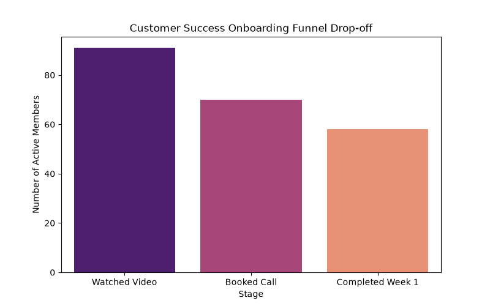
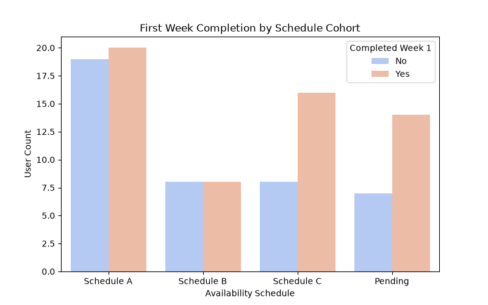

# Community Onboarding & Activation Analytics

A data visualization project solving community retention drop-offs during the critical first week of user onboarding. 

## Problem & Solution
**Problem:** A community platform (1%) is experiencing member churn between the initial welcome video and the completion of their first active week.
**Solution:** This analytics pipeline tracks the member journey (Video -> Call -> Schedule Selection -> Activation) to identify bottleneck stages so Customer Success Specialists can intervene proactively.

## Visualizations
The automated Python script generates charts tracking the onboarding funnel and comparing retention rates across different availability schedules (e.g., Schedule A).

## Onboarding Visualizations

### Funnel Drop-off

### Schedule Activation

